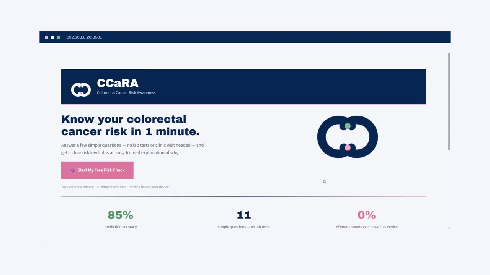
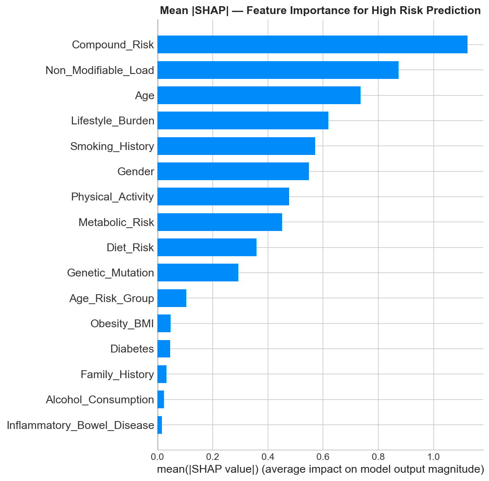
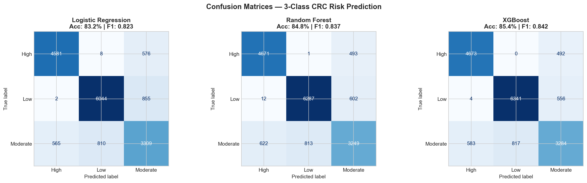
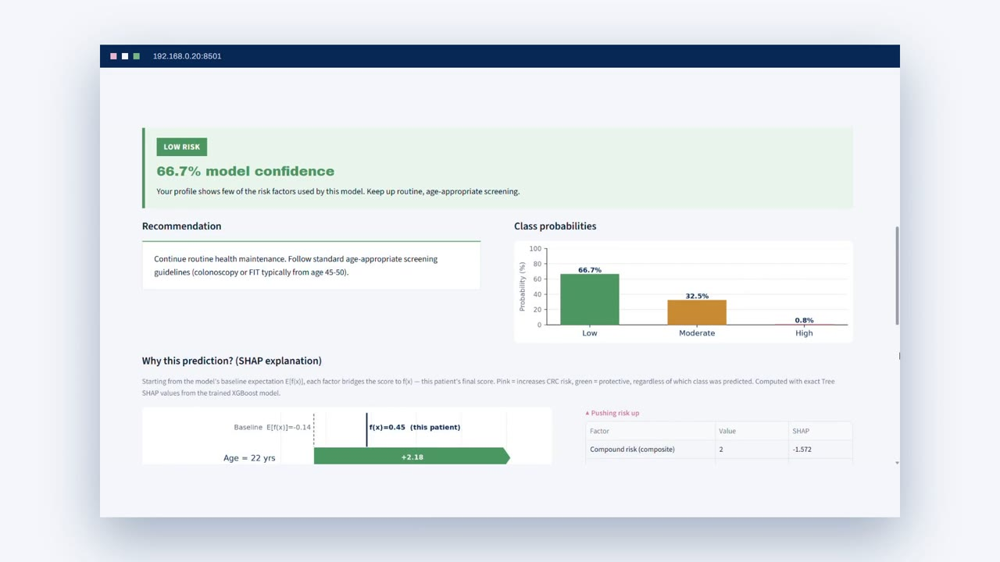
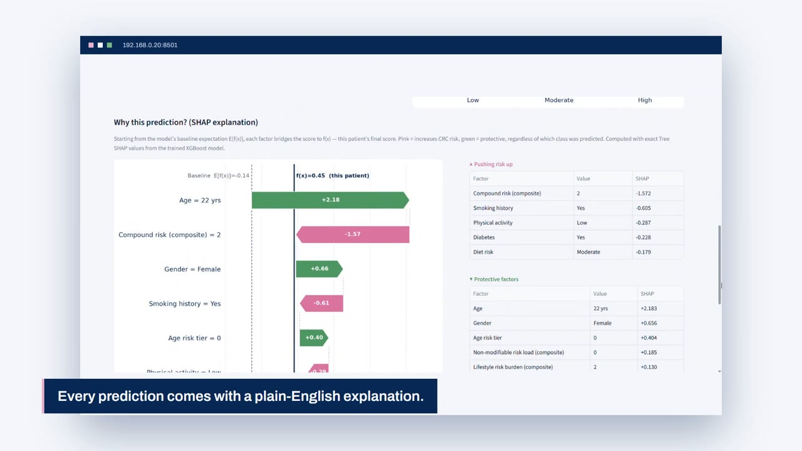

# CCaRA: Colorectal Cancer Risk Awareness

**An explainable XGBoost model that estimates colorectal cancer (CRC) risk from 11 non-invasive
questions, served as a Streamlit app.** No lab tests, imaging or clinic visit needed: answer a
minute of questions about demographics, lifestyle and medical history, and get a risk level
(Low / Moderate / High), the reasons behind it, and a screening recommendation.

Final Year Project, *AI-Based Predictive Model for Early Detection of Colorectal Cancer Risk
Factors using XGBoost*, Bachelor of Information Systems (Hons.) Intelligent Systems Engineering,
Universiti Teknologi MARA (2026).



▶️ **[Watch the demo (1.5 min)](demo/ccara-demo.mp4)**

---

## Why

In Malaysia, around 75% of colorectal cancer cases are diagnosed at Stage III or IV, and the
five-year survival rate is only 18.4%. Screening (colonoscopy, iFOBT) works, but it is invasive,
costly and often skipped. CCaRA explores whether information people already know about
themselves is enough to flag who should prioritise screening, and to explain *why*.

## Results

Held-out test set (16,750 records):

| Model | Accuracy | F1-Macro | F1-Weighted | ROC-AUC (OvR) |
|---|---|---|---|---|
| Logistic Regression | 0.8320 | 0.8230 | 0.8310 | ~0.940 |
| Random Forest | 0.8480 | 0.8370 | 0.8480 | ~0.950 |
| XGBoost (default) | 0.8536 | 0.8423 | 0.8518 | 0.9053 |
| **XGBoost (tuned)** | **0.8549** | **0.8437** | **0.8531** | **0.9050** |

10-fold cross-validation of the tuned model: accuracy 0.8465 ± 0.0050, F1-Macro 0.8436 ± 0.0052,
so it is stable across splits and not overfitting.

<p align="center">
  
  
</p>

The strongest predictors of High risk are combinations of factors rather than any single one:
**Compound Risk** (lifestyle + hereditary burden), **Non-Modifiable Load** (family history,
genetic mutation, IBD) and **Age**. Smoking and overall lifestyle burden are the biggest
modifiable factors.

## How it works

1. **Data.** [Colorectal Cancer Global Dataset and Predictions](https://www.kaggle.com/datasets/ankushpanday2/colorectal-cancer-global-dataset-and-predictions)
   (Kaggle): 167,497 records, 28 variables, 16 countries.
2. **Target engineering.** The dataset's own outcome columns turned out to be statistically
   random (chi-square p > 0.05 against every risk factor), so a new target, `CRC_Risk_Level`,
   was built from 11 literature-backed risk factors with a log-odds-inspired weighting
   (inspired by the LiFeCRC score), plus Gaussian noise, split into tertiles.
3. **Features.** The 11 self-reportable risk factors plus 5 engineered composites:
   Lifestyle Burden, Non-Modifiable Load, Metabolic Risk, Age Risk Group and Compound Risk.
   Post-diagnosis and population-level fields (cancer stage, tumour size, screening history,
   country…) are excluded to avoid leakage.
4. **Training.** Stratified 80/10/10 split, SMOTE on the training set only, Logistic
   Regression and Random Forest as baselines, XGBoost tuned with GridSearchCV
   (5-fold, 1,215 fits, optimising F1-Macro).
5. **Explainability.** SHAP (Tree SHAP) gives both global feature rankings and a per-person
   waterfall showing which answers pushed the risk up or down.
6. **Structural check.** K-Means and Agglomerative clustering independently land on k = 3
   (ARI ≈ 0.20, clearly non-random), supporting the three-tier risk framework.
7. **Urgency profiling.** High-risk results are split further into High-Low, High-Med and
   High-Critical, so the recommendation scales from routine screening to immediate referral.

## The app

| | |
|---|---|
|  |  |
| Risk level, confidence, class probabilities and a recommendation | Tree SHAP waterfall: what drove this prediction |

- **Risk Assessment:** 11 questions, prediction, SHAP waterfall, urgency tier for High risk
- **PDF report:** a one-page summary to bring to a healthcare provider
- **History:** past assessments in a local SQLite database (nothing leaves the device)
- **About:** methodology, the risk factors used, and the disclaimer

## Run it

```bash
cd app
pip install -r requirements.txt
streamlit run app.py
```

Then open http://localhost:8501. Tested with Python 3.12, XGBoost 3.2.0 and Streamlit 1.66.
The model files were saved with scikit-learn 1.7.2, so `pip install scikit-learn==1.7.2`
avoids a version warning.

## Reproduce the model

The full pipeline (cleaning, target engineering, EDA, clustering, model comparison, tuning,
SHAP and the saved model files) is in [`notebook/ccara_model_training.ipynb`](notebook/ccara_model_training.ipynb),
with all outputs. To re-run it, download the dataset from Kaggle, save it next to the notebook
as `colorectal_cancer_dataset.csv`, and run all cells (built with Python 3.13, XGBoost 3.2.0,
SHAP 0.51, imbalanced-learn).

## Repository

```
app/          Streamlit app (pages, utils, trained model in app/model/)
notebook/     Training notebook with outputs
figures/      Key charts from the notebook
docs/         Screenshots
demo/         Demo video
```

## Limitations

- `CRC_Risk_Level` is engineered from published risk weightings, not from real diagnoses, so
  the scores show how well the model recovers that risk structure, not real-world diagnostic
  accuracy.
- The dataset is global and partly synthetic; the model has not been validated on Malaysian
  clinical or screening data.
- The Moderate class is the hardest to separate (F1 ≈ 0.70–0.72), which both the classifiers
  and the clustering agree on: risk is a continuum, not three clean boxes.

> **CCaRA is an awareness prototype, not a diagnostic device.** It does not replace
> professional medical advice, screening or diagnosis.

## Author

**Alya Fariha Azairry**. Supervised by Prof. Dr. Marina binti Yusoff, Universiti Teknologi MARA.
